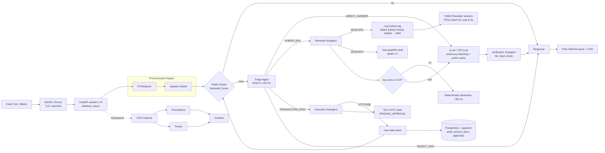

# design.md — "The Unreliable Assistant" → Enterprise-Grade Agent

| Field | Value |
|---|---|
| Status | DRAFT v0.1 (Gate 1 — must be reviewed and locked before any application code) |
| Source | `Unreliable_Assistant_MidCheck_Enterprise_Blueprint_v2.docx` (18 gates) |
| SLA | e2e p50 ≤ 240 ms, p95 ≤ 450 ms, p99 ≤ 590 ms at 50,000 concurrent VUs |

## 0. Spec Reconciliation (decisions that override contradictions in the source)

| # | Conflict in source | Decision |
|---|---|---|
| D1 | FAISS IVF-PQ (Gate 0) vs HNSW (Gate 3) | **HNSW** (efSearch=64). IVF-PQ is a documented fallback only (ADR-5). |
| D2 | Reranker <35 ms (Gate 0) vs <45 ms (Gate 3, KPI-09) | Budget **45 ms**; 35 ms is a stretch target. |
| D3 | Triage <30 ms (Gate 2) vs ≤25 ms (Gate 6, KPI-05) | **25 ms**. |
| D4 | "Audit Subagent" (Gate 2) vs "Verification Subagent" (Gate 7) | **Verification Subagent**; "Audit" is an alias. |
| D5 | 5 steps × 120 ms = 600 ms > loop budget 450 ms | **450 ms total loop budget is binding**; each step timeout = min(120 ms, remaining budget). |
| D6 | Token reduction 55% (Gate 0) vs 45–65% (Gate 17) vs KPI-26 ≥45% | **Gate = 45%, target = 55%**. |
| D7 | 50K VUs with `sleep(1)` ≈ up to 50K RPS vs KPI-35 ≥ 8,500 RPS | KPI-35 is a **floor**. The k6 script uses think-time `sleep(1..5)` (avg 3 s → ~16.7K RPS offered); the floor must hold with ≥35% cache hits. Load test thresholds are tightened to match KPIs (p50<240). |
| D8 | Span names differ (`mcp.rag.bm25` vs `rag.bm25`, `triage.classify` vs `triage`) | Standardize on Gate 10 names (§1.4, §1.5). |
| D9 | "End-to-end" is undefined (full response vs TTFT) | e2e = **request received → last byte of the non-streamed JSON response**. TTFT (KPI-25) applies to the streaming endpoint only. |
| D10 | Spec's k6 script checks `tenant_id` in the response; not an agent contract | Response schema (§1.2.6) **must** echo `tenant_id`. |

## 1.1 System Charter & Hard Boundaries

**Purpose.** A multi-tenant enterprise assistant answering policy/SOP/catalog questions with cited, grounded answers, and performing gated transactions (e.g. lot/SKU workflow transitions).

**In scope:** hybrid RAG over the tenant knowledge vault; MCP-mediated tools; bounded ReAct reasoning; triage/subagent routing; HITL approval for mutations; full observability, audit, and KPI certification.

**Non-goals / hard boundaries**
1. **No autonomous clinical, financial, or legal execution.** Any `risk_tier` ≥ 3 action requires human approval (HITL). No exceptions or override flags.
2. No answer without grounding: if rerank top score < 0.42 the system abstains deterministically (no LLM call).
3. No cross-tenant data access, ever. `tenant_id` is mandatory in every Redis key and SQL predicate.
4. No raw PII persisted (logs, cache, DB, traces).
5. No web access from the Execution Subagent; no mutating tools for the Retrieval Subagent.
6. No unbounded loops: max 5 iterations, 450 ms loop budget.
7. No implementation code before this document is locked.

**Personas**
| Persona | Needs | Rights |
|---|---|---|
| End User | Fast, correct, cited answers; safe transaction requests | TIER_1 read, TIER_2 compute; may *request* TIER_3 |
| Approver / Reviewer | Review and approve/reject `PENDING_APPROVAL` | Approve TIER_3 for own tenant only |
| Platform Engineer | Operate SLOs, runbooks, hot-toggle plugins | Config, no data access to tenants' content |
| Red-Teamer / Auditor | Run adversarial suites, verify audit chain | Read audit log, run test harness |

**RBAC tiers:** `TIER_1_READ` (retrieval, lookup) · `TIER_2_COMPUTE` (validation, calculation, drafting; no side effects) · `TIER_3_MUTATE` (state change; HITL-gated).

## 1.2 MCP Tool & Data Contracts

Transport: JSON-RPC 2.0 over MCP — stdio for local workers (`hybrid-rag`, `graphify-vault`), Streamable HTTP/SSE for `state-store`. All servers ship **signed manifests** (verified at host start).

### 1.2.1 Shared types & constraints (Pydantic v2, `strict=True`, `extra="forbid"`)

```python
from pydantic import BaseModel, Field, ConfigDict
from typing import Annotated, Literal
from uuid import UUID

SKU   = Annotated[str, Field(pattern=r"^SKU-\d{3}$")]
LOT   = Annotated[str, Field(pattern=r"^LOT-\d{5}$")]
TenantId = Annotated[str, Field(pattern=r"^[a-z0-9_]{1,64}$")]
Tier  = Literal["TIER_1_READ", "TIER_2_COMPUTE", "TIER_3_MUTATE"]

class Base(BaseModel):
    model_config = ConfigDict(strict=True, extra="forbid")

class CallContext(Base):            # attached to EVERY tool call by the harness
    tenant_id: TenantId
    user_id: str = Field(max_length=64)
    session_id: UUID
    idempotency_key: UUID           # UUIDv4, enforced
    traceparent: str = Field(pattern=r"^00-[0-9a-f]{32}-[0-9a-f]{16}-0[01]$")
    tier: Tier
```

Auto-repair rules (harness step 2, deterministic, logged, never guess ambiguous input): `SKU99`/`sku 99` → `SKU-099`; `lot 44`/`LOT44` → `LOT-00044`; whitespace/case normalization. If repair is ambiguous → validation error (`-32602`).

### 1.2.2 `mcp-hybrid-rag` (TIER_1_READ)

**Tool `hybrid_retrieve`**
```python
class HybridRetrieveIn(Base):
    ctx: CallContext
    query: str = Field(min_length=1, max_length=2000)
    bm25_top_k: int = Field(50, ge=5, le=50)       # 25 under latency incident
    dense_top_k: int = Field(50, ge=5, le=50)
    rrf_k: int = Field(60, ge=1, le=200)
    fusion_pool: int = Field(40, ge=4, le=100)
    rerank_k: int = Field(4, ge=1, le=10)
    score_threshold: float = Field(0.42, ge=0.0, le=1.0)   # 0.55 under hallucination incident

class Chunk(Base):
    chunk_id: str
    chunk_hash: str
    text: str
    source_uri: str
    bm25: float | None; cosine: float | None; rrf_rank: int | None; rerank: float | None

class HybridRetrieveOut(Base):
    chunks: list[Chunk]              # <= rerank_k, all with rerank >= threshold
    top_score: float
    abstain: bool                    # True iff top_score < score_threshold
    stage_ms: dict[str, float]       # bm25, dense, rrf, rerank
```
**Resource** `rag://chunks/{chunk_id}` → chunk text + metadata (tenant-scoped; cross-tenant id returns `-32003`).

### 1.2.3 `mcp-graphify-vault` (TIER_1_READ)

**Tool `resolve_subgraph`**: input `{ctx, query, anchor_hint?: str, depth: int (1..2, default 2), max_tokens: int (≤400)}` → output `{anchor_id, nodes: [{id, domain, risk_tier, version, text}], edges: [[src, dst]], token_estimate}`. Traverses ≤ 2 hops of `[[wikilinks]]` / code-dependency edges; target ≈ 320 tokens vs ≈ 1,400 raw.

### 1.2.4 `mcp-state-store`

| Tool | Tier | Input (besides `ctx`) | Output |
|---|---|---|---|
| `cache_get` | T1 | `key_hash: str(64 hex)` | `{hit, value?, cosine?}` |
| `cache_put` | T1 | `key_hash, value, ttl_s (255..345)` | `{ok}` |
| `session_facts_get` | T1 | `limit: int ≤ 50` | `{facts: [{fact_id, text, verified_at}]}` |
| `session_facts_put` | T2 | `text: str ≤ 500, evidence_chunk_ids: list[str]` | `{fact_id}` |
| `audit_append` | T1 (system only) | `event: AuditEvent` | `{seq, hash}` |
| `workflow_transition` | **T3** | `lot: LOT, from_state, to_state, reason` | `{status: "PENDING_APPROVAL", approval_id}` (never executes directly) |
| `approval_decide` | T3 (Approver role) | `approval_id: UUID, decision: "APPROVE"\|"REJECT", comment` | `{status}` |

Audit hash chain: `hash_n = SHA256(hash_{n-1} || canonical_json(event_n))`; tenant-scoped chains; genesis hash fixed per tenant.

### 1.2.5 Error codes

| Code | Name | Meaning | Client behavior |
|---|---|---|---|
| -32700 | PARSE_ERROR | Invalid JSON | fail |
| -32600 | INVALID_REQUEST | Bad JSON-RPC envelope | fail |
| -32601 | METHOD_NOT_FOUND | Unknown tool | fail |
| -32602 | INVALID_PARAMS | Pydantic validation failed (after auto-repair) | feed back once to ReAct |
| -32603 | INTERNAL_ERROR | Server fault | retry ≤1 (idempotent), then fallback |
| -32001 | TIMEOUT | Exceeded per-call budget (150 ms RAG) | FMEA fallback |
| -32002 | BREAKER_OPEN | Circuit breaker / bulkhead open | `HALTED_BREAKER` |
| -32003 | RBAC_DENIED | Tier or tenant violation | fail closed, audit |
| -32004 | PII_BLOCK | Unredactable PII detected | fail closed |
| -32005 | PENDING_APPROVAL | Awaiting HITL | return 202 + approval_id |
| -32006 | IDEMPOTENT_REPLAY | Duplicate idempotency_key | return original result |
| -32007 | INJECTION_BLOCKED | Injection shield tripped | refuse |
| -32008 | ABSTAIN | Below-threshold evidence | deterministic abstention response |

### 1.2.6 Public API

`POST /api/v1/agent/query`
```python
class QueryIn(Base):  tenant_id: TenantId; user_id: str; query: str = Field(max_length=4000); session_id: UUID | None
class QueryOut(Base):
    tenant_id: TenantId; session_id: UUID; trace_id: str
    status: Literal["ANSWERED","ABSTAINED","REFUSED","PENDING_APPROVAL","HALTED_BREAKER"]
    answer: str | None; citations: list[str]; faithfulness: float | None
    approval_id: UUID | None; remediation: str | None
```
Header `X-Tenant-ID` must equal body `tenant_id` (else 403). Streaming variant `/api/v1/agent/query/stream` (SSE) for KPI-25.

### 1.2.7 Config & plugin registry
`mcp_config.json` as in the source (3 servers, 5 plugins). Plugin interface (Pluggy):
```python
class Plugin(Protocol):
    name: str; stage: Literal["PRE_EXECUTION","TOOL_DISPATCH","POST_EXECUTION","ALL_SPANS"]
    priority: int; fail_closed: bool
    async def run(self, state: AgentState) -> HookResult: ...   # ALLOW | MODIFY | BLOCK
```
Order: lower priority number runs first. `fail_closed=True` + plugin error/timeout ⇒ request refused. Hot-toggle allowed for non-security plugins only (`pii_redactor` and `injection_shield` cannot be disabled in prod).

## 1.3 Distributed Topology & Data Flow



**Control plane around the ReAct loop:** `INIT → TRIAGE → REASONING → TOOL_CALL → OBSERVATION → VERIFY → DONE | HALTED | HALTED_BREAKER`. Every `TOOL_CALL` goes through `ToolExecutionHarness`: (1) strict Pydantic validation → (2) regex auto-repair → (3) RBAC tier check → (4) UUIDv4 idempotency → circuit breaker → dispatch.

**Bulkheads** (isolated pools): `rag_pool=64`, `db_pool=128`, `llm_pool=256`; health checks and triage run on a reserved pool, never starved by slow RAG.

**Tenant isolation boundaries:** Redis key = `t:{tenant_id}:{SHA256(tenant_id:user_id:norm_query)}` with jittered TTL 300 ± 45 s; every SQL statement carries `WHERE tenant_id = $1` (enforced by a repository layer + Postgres RLS); vault retrieval filtered by tenant namespace.

**Memory model:** `GoalAnchorBlock` (original intent, normalized entity IDs, policy constraints) pinned at prompt index 0, immutable; observations compressed to ≤ 180 tokens (extractive; strips boilerplate JSON keys); hot window = last 3 ReAct turns (Redis/RAM); verified facts persisted in Postgres `session_facts(session_id, tenant_id, …)`.

**Subagent isolation matrix**
| Subagent | Responsibility | MCP bound | Rule |
|---|---|---|---|
| Retrieval | Query rewrite, 3-stage RAG, citation grounding | hybrid-rag, graphify-vault | Read-only; cannot call mutating tools |
| Execution | Schema validation, submissions, workflow transitions | state-store | No RAG / no web; T3 ⇒ HITL freeze |
| Verification | Claim→chunk NLI, RAGAS triad, OTel | state-store (audit only) | Independent context; may veto ungrounded drafts |

**Triage:** distilled classifier, temp 0.0, ≤ 25 ms, outputs `(intent, domain, risk_tier, complexity)` → route in {`DIRECT_ANSWER`, `HYBRID_RAG`, `TRANSACTION_EXEC`, `REJECT_OOS`}. `risk_tier=3` always forces HITL regardless of route.

## 1.4 End-to-End Latency Budget

Spans (standardized): `hook.pre`, `cache.lookup`, `triage.classify`, `mcp.rag.bm25`, `mcp.rag.biencoder`, `mcp.rag.rrf`, `mcp.rag.rerank`, `agent.react.step`, `llm.generate`, `hook.post.ragas`. W3C `traceparent` propagated across every hop including MCP calls.

### Path A — HYBRID_RAG, cache miss (critical path, p95 budget)
| # | Hop | p95 budget (ms) | Note |
|---|---|---|---|
| 1 | Gateway + API accept | 5 | |
| 2 | `hook.pre` (PII → injection) | 15 | KPI-01 |
| 3 | `cache.lookup` | 5 | Redis, sub-ms + network |
| 4 | `triage.classify` | 25 | KPI-05 |
| 5 | MCP JSON-RPC overhead (RAG call) | 4 | KPI-30 |
| 6 | BM25 ∥ bi-encoder+HNSW (parallel → max) | 25 | BM25 12, dense 25 |
| 7 | RRF fusion | 3 | |
| 8 | Cross-encoder rerank | 45 | KPI-09 |
| 9 | Graphify subgraph (parallel with 6–8, not on path) | 0 | ≤ 20 ms, overlapped |
| 10 | Prompt assembly + compression | 5 | |
| 11 | `llm.generate` (~320-token prompt, short grounded answer) | 250 | vLLM continuous batching, prefix cache |
| 12 | Verification (NLI claim check) | 30 | |
| 13 | Serialize + egress | 10 | |
| | **Sum** | **422** | |
| | Headroom (queueing, GC, batching wait 8 ms) | 28 | |
| | **Total p95** | **450** | ✔ matches KPI-32 |

`hook.post.ragas` runs **asynchronously** off the critical path (sampled 100% in CI, 10% in prod).
p99 allowance: 590 ms = p95 path + 140 ms tail (one retry within the 450 ms loop budget is *not* allowed on this path; tail covers queueing and batch wait only).

### Other paths
| Path | p95 target | Composition |
|---|---|---|
| Cache hit | ≤ 60 ms | 5+15+5 + serialize 10 + overhead |
| Abstention short-circuit | < 90 ms | 5+15+5+25+4+25+3+45 → **127 ms** if full RAG; so abstention is also reached early: BM25/dense empty or low-score pre-check ends < 90 ms; full-RAG abstention must meet ≤ 140 ms (documented exception, see FMEA-4/ADR-6) |
| DIRECT_ANSWER | ≤ 300 ms | 5+15+5+25 + LLM 200 + verify 30 + egress 10 |
| TRANSACTION_EXEC | ≤ 200 ms to `PENDING_APPROVAL` | harness + Postgres insert (≤ 20 ms); approval wait is out-of-band and excluded from SLA |
| REJECT_OOS | ≤ 60 ms | no LLM |

> **Open item OI-1:** the spec's abstention budget (<90 ms) cannot include a full 45 ms rerank + triage on the same path (sum 127 ms). Proposal: early-abstain on empty/very-low RRF pool (skip rerank), and report abstention p95 separately from KPI-33. Needs reviewer sign-off at lock.

### Loop budget
`max_iterations=5`, `total_loop_budget=450 ms`, `per_step_timeout=min(120 ms, remaining)`. Target mean steps ≤ 2.2 (KPI-17): the RAG path normally needs a single reasoning step.

### Capacity model for 50K VUs (to validate in load test)
- Offered load ≈ 50,000 VUs / (think ~3 s + 0.3 s) ≈ **15K RPS peak**; floor KPI-35 = 8,500 RPS sustained.
- FastAPI: ~400–600 RPS per worker on cache-miss path → ≥ 40 workers (HPA, 2× headroom → 80).
- Redis Cluster: 6+ shards (3 primary/3 replica minimum); hit-ratio ≥ 35% removes ≥ 5K RPS from the RAG path.
- Reranker: batch 32, max_wait 8 ms; ~6.5K RPS cache-miss RAG ⇒ ≥ 6 GPU/CPU-INT8 replicas.
- vLLM/TRT-LLM: continuous batching + prefix caching; abstentions (~15% of golden set) and cache hits bypass the LLM.
- Load generators: k6 distributed (≥ 10 injectors) and JMeter 1 controller + 10 workers × 5,000 threads.

## 1.5 KPI & SLA Gate Matrix (36 KPIs — all are CI/CD hard gates)

| ID | Stage | Metric | Threshold | Tool / span |
|---|---|---|---|---|
| KPI-01 | Ingress & Triage | Pre-hook guardrail latency p95 | ≤ 15 ms | `hook.pre` |
| KPI-02 | Ingress & Triage | PII redaction recall (email/phone/SSN/obfuscated) | ≥ 99.8% | Presidio/regex audit |
| KPI-03 | Ingress & Triage | Prompt-injection block rate (direct+indirect) | ≥ 99.5% | Red-team benchmark |
| KPI-04 | Ingress & Triage | Triage routing accuracy | ≥ 97.0% | Labeled intent set |
| KPI-05 | Ingress & Triage | Triage latency p95 | ≤ 25 ms | `triage.classify` |
| KPI-06 | Ingress & Triage | False-positive refusal on benign | ≤ 1.0% | Benign control set |
| KPI-07 | Hybrid Retrieval | BM25 latency p95 | ≤ 12 ms | `mcp.rag.bm25` |
| KPI-08 | Hybrid Retrieval | Bi-encoder + FAISS latency p95 | ≤ 25 ms | `mcp.rag.biencoder` |
| KPI-09 | Hybrid Retrieval | Cross-encoder latency p95 | ≤ 45 ms | `mcp.rag.rerank` |
| KPI-10 | Hybrid Retrieval | Hybrid Context Recall@50 | ≥ 0.92 | RAGAS / IR eval |
| KPI-11 | Hybrid Retrieval | Post-rerank Context Precision@4 | ≥ 0.88 | RAGAS |
| KPI-12 | Hybrid Retrieval | MRR@4 | ≥ 0.85 | IR script |
| KPI-13 | Hybrid Retrieval | nDCG@4 | ≥ 0.86 | IR script |
| KPI-14 | Agent & Loop | Tool schema first-pass validation rate | ≥ 96.0% | Pydantic telemetry |
| KPI-15 | Agent & Loop | Auto-repair success on malformed args | ≥ 90.0% | Harness metrics |
| KPI-16 | Agent & Loop | Infinite-loop escape rate (breaker) | 100.0% | Chaos loop suite |
| KPI-17 | Agent & Loop | Mean ReAct steps / completed task | ≤ 2.2 | `agent.react.step` count |
| KPI-18 | Agent & Loop | Context drift (goal cosine alignment) | ≥ 0.85 | Embedding drift audit |
| KPI-19 | Agent & Loop | Tier-3 HITL gate enforcement | 100.0% | Audit-log integrity |
| KPI-20 | Generation & RAGAS | Faithfulness | ≥ 0.92 | `hook.post.ragas` |
| KPI-21 | Generation & RAGAS | Answer relevancy | ≥ 0.90 | `hook.post.ragas` |
| KPI-22 | Generation & RAGAS | Context entity recall | ≥ 0.85 | `hook.post.ragas` |
| KPI-23 | Generation & RAGAS | Unanswerable abstention accuracy | ≥ 98.0% | Negative test set |
| KPI-24 | Generation & RAGAS | Unsupported-claim / hallucination rate | ≤ 0.5% | NLI verifier |
| KPI-25 | Generation & RAGAS | TTFT p95 (streaming) | ≤ 180 ms | FastAPI stream metric |
| KPI-26 | Token & Graphify | Prompt-token reduction | ≥ 45.0% (target 55%) | Token counter hook |
| KPI-27 | Token & Graphify | Semantic cache hit ratio (steady state) | ≥ 35.0% | Redis hit/miss |
| KPI-28 | Token & Graphify | Cross-tenant cache isolation | 100% (0 leaks) | Concurrency probe |
| KPI-29 | Token & Graphify | Cost / 1,000 queries | ≤ $0.45 | OTel token-cost calc |
| KPI-30 | Token & Graphify | MCP JSON-RPC serialization overhead p95 | ≤ 4 ms | MCP client timer |
| KPI-31 | Scale & Load | e2e p50 @ 50K VUs | ≤ 240 ms | k6 + JMeter |
| KPI-32 | Scale & Load | e2e p95 @ 50K VUs | ≤ 450 ms | k6 + JMeter |
| KPI-33 | Scale & Load | e2e p99 @ 50K VUs | ≤ 590 ms | k6 + JMeter |
| KPI-34 | Scale & Load | HTTP 5xx rate @ 50K VUs | ≤ 0.05% | k6 / JMeter |
| KPI-35 | Scale & Load | Sustained throughput | ≥ 8,500 RPS | k6 / JMeter |
| KPI-36 | Scale & Load | RSS growth over 1-h soak | ≤ 3.0% | Prometheus node exporter |

**Release gates (RAGAS, 250-question golden set; stratified Factoid 25% / Complex Reasoning 25% / Multi-Hop 20% / Summary 15% / Negative 15%):** Faithfulness ≥ 0.92, Answer Relevancy ≥ 0.90, Context Precision ≥ 0.88, Context Recall ≥ 0.85, Context Entity Recall ≥ 0.85.

**Gate semantics:** any KPI failure blocks release. KPIs 31–36 are evaluated only on full 50K runs; KPIs 1–30 run per-PR on the golden/red-team/benchmark sets.

## 1.6 Failure Mode & Effects Analysis (12 rows)

| # | Failure | Sev | Detection | Deterministic fallback | Runbook |
|---|---|---|---|---|---|
| 1 | Redis cluster down / slow | High | cache span error, Redis CPU/timeouts | Bypass cache (fail-open for *read cache only*); tenant-keyed local LRU (60 s); shed load via token bucket; never serve unscoped keys | R-CACHE |
| 2 | Reranker timeout (>45 ms ×N) | High | `mcp.rag.rerank` timeout | Use RRF top-4 with *raised* threshold semantics: return extractive-quote-only answer flagged `degraded`; abstain if RRF score below calibrated floor | R-RERANK |
| 3 | `mcp-hybrid-rag` crash/hang (>150 ms, >1%) | High | JSON-RPC timeout rate | Trip bulkhead breaker; fail over to cached read-replica index; restart worker; return `HALTED_BREAKER` remediation if replica unavailable | R-MCP |
| 4 | Low-evidence / empty retrieval | Med | `top_score < 0.42` | Abstention short-circuit (no LLM) | R-ABSTAIN |
| 5 | LLM 429 / 5xx | High | HTTP status from `llm.generate` | Backoff w/ jitter ≤1 retry inside budget → secondary model pool → extractive answer from top chunk; else `503` with `Retry-After` | R-LLM |
| 6 | PostgreSQL primary failover | High | `db_pool` errors | Writes queue to durable outbox; T3 mutations **refuse** (fail closed); reads from replica; audit append retried, never dropped | R-PG |
| 7 | PII redactor error/timeout | Crit | plugin exception | `fail_closed`: refuse request (`-32004`); no bypass | R-PII |
| 8 | Injection shield error/timeout | Crit | plugin exception | `fail_closed`: refuse (`-32007`) | R-INJ |
| 9 | Infinite tool loop (same `(tool, args_hash)` fails ≥ 2) | Med | circuit breaker | `HALTED_BREAKER` + structured remediation prompt | R-LOOP |
| 10 | HITL reviewer unavailable / approval stale | Med | pending age > SLA | Remain `PENDING_APPROVAL`; escalate/notify; auto-expire to `REJECTED` after TTL; never auto-approve | R-HITL |
| 11 | Cache stampede / tenant key collision | High | Redis CPU > 85%, collision probe | Enforce `SHA256(tenant:user:norm_query)` prefix, jittered TTL 300±45 s, single-flight lock per key; purge namespace on collision | R-STAMPEDE |
| 12 | OTel collector / Tempo down; stale FAISS index | Med | exporter errors; index version mismatch | Buffer spans in bounded ring (drop-oldest, count drops); serving unaffected. Stale index: serve with `index_version` flag, alert, block ingest-dependent releases | R-OBS |

## 1.7 Architecture Decision Records

**ADR-1 — Hybrid retrieval via RRF (k=60), not weighted-sum**
- Context: BM25 scores and cosine similarities are incomparable scales.
- Decision: Reciprocal Rank Fusion, k=60, dedup by `chunk_hash`, pool 40 → rerank → top 4.
- Why: scale-free, no per-corpus tuning, robust to either retriever failing. Both retrievers contribute (top_k 50 each).
- Consequences: loses raw-score magnitude; the cross-encoder restores precision. Revisit if KPI-10 < 0.92.

**ADR-2 — ONNX Runtime with FP16 (INT8 fallback) + dynamic micro-batching**
- Decision: `bge-reranker-v2-m3` and `bge-large-en-v1.5` exported to ONNX; FP16 on GPU, INT8 on CPU; batch 32, max wait 8 ms.
- Why: meets 45 ms / 25 ms stage budgets; throughput scales with batching.
- Guardrail: quantized model must stay within **≤ 1% absolute drop** in nDCG@4/MRR@4 vs FP32 baseline (KPI-12/13) or quantization is rejected.

**ADR-3 — Redis key isolation by tenant-scoped hashed keys**
- Decision: `t:{tenant_id}:{SHA256(tenant_id:user_id:norm_query)}`; jittered TTL 300 ± 45 s; per-tenant keyspace metrics; semantic-cache matches only within the same tenant namespace (cosine ≥ 0.92 under latency incident, default stricter).
- Why: prevents cross-tenant leakage (KPI-28), limits stampedes via jitter and single-flight.
- Consequences: lower cross-user hit rate; offset by per-tenant shared policy queries where user-independent (explicitly allow-listed, tenant-scoped only).

**ADR-4 — Bounded ReAct (max 5 steps, 450 ms budget, no recursive self-calls)**
- Decision: explicit state machine; budgets enforced by the harness, not the LLM; breaker on `(tool, args_hash)` ≥ 2 failures.
- Why: eliminates runaway tool loops; makes latency provable. Per D5, loop budget is binding.

**ADR-5 — FAISS HNSW over IVF-PQ**
- Decision: HNSW (efSearch=64, top_k 50) per Gate 3. IVF-PQ reserved for corpora where RAM exceeds the budget (>~50M vectors).
- Why: better recall at low latency with small/medium enterprise corpora; supports the <25 ms stage budget. Trade-off: higher memory.

**ADR-6 — Deterministic abstention at rerank score < 0.42**
- Decision: no LLM call below threshold; fixed template response citing "insufficient evidence"; threshold raised to 0.55 and strict extractive-quote mode during hallucination incidents.
- Why: zero hallucination risk on unanswerable queries (KPI-23/24), ~80% token savings on those queries.
- Calibration: threshold tuned on the negative set (15% of golden set); re-validate after each model/index change.

## Appendix A — Governance & Security-in-Build
- SHA-256 hash-chained, append-only audit log; tenant-scoped chains; verification job nightly (KPI-19 evidence).
- Zero raw PII persisted: redaction happens before cache, logs, traces, DB. Only tokenized placeholders stored.
- Signed MCP server manifests verified at startup; unsigned/changed manifests refuse to load.
- Secrets via env/secret manager only; least-privilege DB roles; Postgres RLS on `tenant_id`.

## Appendix B — Observability & Incident Runbooks

| Scenario | Alert | Mitigation |
|---|---|---|
| Latency breach | p95 e2e > 550 ms for 30 s | Cosine cache threshold ≥ 0.92 (aggressive), BM25/dense `top_k` 50→25 |
| Hallucination surge | RAGAS faithfulness < 0.90 (5 min) | Cross-encoder cutoff 0.42→0.55; strict extractive quote mode |
| MCP hang | JSON-RPC timeout > 150 ms, > 1% | Trip bulkhead circuit; failover to cached read-replica index; restart worker |
| Cache stampede / leak | Tenant key collision or Redis CPU > 85% | Enforce key prefix + jittered TTL 300 ± 45 s; single-flight; purge namespace |

Pipeline: W3C `traceparent` → OTel Collector → Prometheus + Tempo + Grafana.

## Appendix C — Token Optimization
Atomic Obsidian notes in `knowledge_vault/` (YAML: `id`, `domain`, `risk_tier`, `version`; explicit `[[wikilinks]]`). `graphify build ./src ./knowledge_vault --output graph.json`. At runtime `mcp-graphify-vault` resolves the anchor and traverses ≤ 2 hops (~320 vs ~1,400 tokens). Observations ≤ 180 tokens.

## Appendix D — Test Plan
| Suite | Scope | Gates |
|---|---|---|
| Golden set | 250 Qs (25/25/20/15/15) with RAGAS | KPI-10,11,20–23; release gates |
| Red team | 100 prompts: direct jailbreak/system-prompt extraction; indirect injection in Obsidian/PDF chunks; multi-turn crescendo; Unicode homoglyph + `name[at]domain` PII smuggling; tool-arg overflow/SQLi fuzz | KPI-02,03,06 |
| Chaos | Infinite SKU retry loop; Redis/MCP/LLM fault injection (FMEA rows) | KPI-16, FMEA validation |
| Isolation probe | Concurrent multi-tenant identical queries | KPI-28 |
| k6 | `load_tests/k6_50k_load.js`; stages 2m→10K, 3m→50K, 5m hold, 2m down; thresholds p50<240, p95<450, p99<590, fail<0.0005; tenant echo check | KPI-31–35 |
| JMeter | `load_tests/jmeter_50k_plan.jmx`; 1 controller + 10 workers × 5,000 threads, ramp 180 s, 600 s; Duration Assertion 600 ms; JSONPath `$.faithfulness >= 0.92`; Backend Listener | KPI-31–35 |
| Soak | 1 h at steady load | KPI-36 |

## Appendix E — Streamlit Workbench (`app.py`) ↔ Gates
1. Architecture & Workflow: this doc's checklist, `docs/workflow_orchestration.png`, triage console, ReAct trace, HITL queue.
2. 3-Stage RAG Lab: BM25 / cosine / RRF / rerank tables; sliders `k1`, `b`, `RRF k`, `threshold`.
3. MCP & Plugin Inspector: server status, JSON-RPC payloads, plugin hot-toggles (security plugins locked).
4. Memory & Graphify Tokens: subgraph viewer, note viewer, session state browser, token/cost gauge.
5. Red Team & Circuit Breaker: one-click adversarial runner, breaker trip/reset.
6. 36-KPI Scorecard & 50K Load: span waterfall, RAGAS gauges, latency histogram vs SLA, pass/fail scorecard.

## Appendix F — Gate 2 Diagram Spec (`docs/workflow_orchestration.png`, 300 DPI, Graphviz)
Must show: Ingress → Pre plugins (PII Redactor → Injection Classifier) → Redis semantic cache check; Triage (temp 0.0, ≤25 ms) → Direct / Retrieval / Execution / Verification(Audit); MCP calls to `mcp-hybrid-rag` (BM25 + bi-encoder → RRF → cross-encoder), `mcp-graphify-vault`, `mcp-state-store`; Bounded ReAct (max 5) → Circuit Breaker → Tier-3 HITL → RAGAS + OTel export.

## Appendix G — Build Order (after this doc is locked)
1. Gate 2 diagram. 2. Contracts + harness + state machine (Pydantic, breaker, RBAC, idempotency). 3. `state-store` + audit chain. 4. `hybrid-rag` (stage by stage with KPI spans). 5. Triage + subagents + HITL. 6. Plugins (PII, injection, RAGAS, OTel). 7. Graphify/Obsidian. 8. Golden/red-team/chaos suites. 9. k6/JMeter 50K. 10. Streamlit workbench. 11. Full 36-KPI certification.

## Appendix H — Open Items for Lock Review
- **OI-1** Abstention <90 ms vs full-RAG path (see §1.4).
- **OI-2** Choice of LLM and triage model (affects the 250 ms generation budget and KPI-29 cost ≤ $0.45/1K).
- **OI-3** Hardware assumptions for 50K VUs (GPU vs CPU-INT8 reranker replicas).
- **OI-4** Domain of the knowledge vault / transactions (spec is domain-neutral; SKU/LOT examples assumed).

---

# PART II — Source-Faithful Specification (verbatim/complete carry-over from the docx, Gates 0–18)

> Part I above is the reconciled design. Part II preserves every parameter, table and artifact from the source blueprint so the agent can be built from this file alone. Where Part II conflicts with Part I, **§0 decisions win**.

## S0. Gate 0 — Enterprise Stack, MCP Servers & Plugin Architecture

All tool integrations go through MCP over JSON-RPC 2.0 (stdio for local workers, Streamable HTTP/SSE for distributed microservices) and modular lifecycle plugins.

| Layer / Capability | Selected Tool / Protocol | MCP Server / Plugin Binding | Justification |
|---|---|---|---|
| Agent Runtime & API | Python 3.11 + FastAPI + Uvicorn (async) | MCP Host Client (`mcp.ClientSession`) | Non-blocking async I/O sustaining 50,000 concurrent connections |
| Sparse & Dense Retrieval | Rank-BM25 + FAISS (IVF-PQ in Gate 0 → **HNSW per D1**) + BGE-Large | MCP Server `mcp-hybrid-rag` (Resources + Tools) | Exposes `rag://chunks/{id}` resources and `hybrid_retrieve` tool over JSON-RPC |
| Precision Reranker | ONNX Runtime (`bge-reranker-v2-m3` FP16) | In-process Triton / ONNX microservice | Sub-35 ms (stretch; budget 45 ms per D2) via INT8/FP16 quantization and dynamic batching |
| State & Session Cache | PostgreSQL (pgvector) + Redis Cluster | MCP Server `mcp-state-store` | ACID long-term audit persistence + sub-ms tenant-isolated Redis caching |
| Token Compression | Obsidian Vault + Graphify AST/Link Engine | MCP Server `mcp-graphify-vault` | Traverses 1-hop/2-hop `[[wikilinks]]` and code dependency graphs to cut tokens ~55% |
| Lifecycle Plugins | Pluggy / Entry-Point Hook Registry | Pre-Hook, Post-Hook, PII, OTel, HITL Plugins | Hot-swappable deterministic interceptors decoupled from core LLM reasoning |

**`mcp_config.json` (verbatim):**
```json
{
  "mcpServers": {
    "hybrid-rag": {"command": "uv", "args": ["run", "mcp_servers/rag_server.py"], "transport": "stdio", "timeout_ms": 150},
    "state-store": {"url": "http://localhost:8081/mcp", "transport": "streamable-http", "pool_size": 200},
    "graphify-vault": {"command": "uv", "args": ["run", "mcp_servers/graphify_server.py"], "transport": "stdio"}
  },
  "plugins": [
    {"name": "pii_redactor", "stage": "PRE_EXECUTION", "priority": 10, "fail_closed": true},
    {"name": "injection_shield", "stage": "PRE_EXECUTION", "priority": 20, "fail_closed": true},
    {"name": "circuit_breaker", "stage": "TOOL_DISPATCH", "priority": 10, "max_identical_calls": 2},
    {"name": "ragas_auditor", "stage": "POST_EXECUTION", "priority": 10, "min_faithfulness": 0.92},
    {"name": "otel_exporter", "stage": "ALL_SPANS", "endpoint": "http://localhost:4317"}
  ]
}
```

## S1. Gate 1 / Gate 2 — Hard Gates
- **Gate 1:** no implementation code until `design.md` is authored, reviewed and locked in the repo root (this file).
- **Gate 2:** generate `docs/workflow_orchestration.png` at **300 DPI** via Graphviz (`diagrams` / `graphviz` Python lib) **before** application logic, and render it in **Streamlit Tab 1**. Required content (see Appendix F): Ingress & Security Layer; Triage & Subagent Routing (Direct Response, Retrieval, Execution, Audit/Verification); MCP & 3-Stage RAG Pipeline; Control Plane & Egress (Bounded ReAct `max_steps=5` → Circuit Breaker → Tier 3 HITL Gate → Post-Execution RAGAS & OTel Export).

## S2. Gates 3 & 8 — 3-Stage Hybrid RAG inside `mcp_servers/rag_server.py`

| Stage | Engine | Hyperparameters | Latency budget | Output |
|---|---|---|---|---|
| 1 Sparse Lexical | BM25Okapi + PorterStemmer + Inverted Index | k1=1.25, b=0.75, top_k=50, pre-tokenized | < 12 ms | 50 lexical candidates + raw BM25 scores |
| 2 Dense Semantic | Bi-Encoder `bge-large-en-v1.5` (ONNX) + FAISS HNSW | chunk=512 tok, overlap=64 tok, efSearch=64, top_k=50 | < 25 ms | 50 semantic candidates + cosine similarity |
| Rank Fusion | Reciprocal Rank Fusion | smoothing k=60, dedup by `chunk_hash`, pool=40 | < 3 ms | Top 40 unified, scale-normalized candidates |
| 3 Cross-Encoder | `bge-reranker-v2-m3` (ONNX FP16, batch=32) | rerank_k=4, sigmoid threshold > 0.42, max_len=512 | < 45 ms | Top 4 verified chunks + confidence |

**RAGAS continuous evaluation (Step 8):** automated scoring over the 250-question golden dataset, stratified Factoid 25% / Complex Reasoning 25% / Multi-Hop 20% / Summary 15% / Negative-Unanswerable 15%. Release gates: Faithfulness ≥ 0.92, Answer Relevancy ≥ 0.90, Context Precision ≥ 0.88, Context Recall ≥ 0.85, Context Entity Recall ≥ 0.85. Runs in CI on every change to retrieval, prompts, models, or index; also sampled in production via `ragas_auditor` (min_faithfulness 0.92).

## S3. Gate 4 — Harness Engineering & Loop Engineering
**`ToolExecutionHarness`** — every MCP tool call passes, in order: (1) Pydantic v2 strict validation → (2) deterministic regex auto-repair (`SKU99`→`SKU-099`, `lot 44`→`LOT-00044`) → (3) RBAC tier check (`TIER_1_READ`, `TIER_2_COMPUTE`, `TIER_3_MUTATE`) → (4) `UUIDv4` idempotency enforcement.

**Bounded loop state machine:** `INIT → TRIAGE → REASONING → TOOL_CALL → OBSERVATION → VERIFY → DONE/HALTED`. Hard limits: `max_iterations=5`, `per_step_timeout=120 ms`, `total_loop_budget=450 ms`, zero recursive self-calls without state mutation.

## S4. Gate 5 — Context Retention & Drift Control (ReAct)
1. **Immutable Goal Anchoring:** prepend an immutable `GoalAnchorBlock` (original user intent, normalized entity IDs, active policy constraints) at index 0 of every ReAct prompt.
2. **Observation Compression:** every tool response passes through an extractive compressor that strips boilerplate JSON keys and truncates to ≤ 180 tokens.
3. **Sliding Window + Dual Memory:** only the last 3 ReAct turns kept hot (Redis/RAM); verified facts persisted in PostgreSQL table `session_facts` keyed by `session_id`.
Measured by KPI-18 (goal cosine alignment ≥ 0.85).

## S5. Gates 6 & 7 — Triage Agent & Subagent Topology
**Triage (Step 6):** ultra-fast distilled classifier, ≤ 25 ms inference, temperature 0.0; tags `(intent, domain, risk_tier, complexity)`; routes to `DIRECT_ANSWER`, `HYBRID_RAG`, `TRANSACTION_EXEC`, or `REJECT_OOS`.

| Subagent | Core responsibility | Bound MCP servers | Isolation & guardrail |
|---|---|---|---|
| Retrieval | Query rewriting, 3-stage Hybrid RAG, citation grounding | `mcp-hybrid-rag`, `mcp-graphify-vault` | Read-only; cannot invoke state-mutating tools |
| Execution | Schema validation, form submission, workflow transitions | `mcp-state-store` | No RAG / external web; Tier 3 triggers HITL freeze |
| Verification | Claim-to-chunk NLI check, RAGAS triad audit, OTel logging | `mcp-state-store` (audit log only) | Independent model context; vetoes ungrounded drafts |

## S6. Gate 9 — Enterprise Design Patterns & Reliability
1. **Idempotent Circuit Breaker:** trips if `(tool_name, canonical_args_hash)` fails ≥ 2 times → state `HALTED_BREAKER` → returns a structured user remediation prompt.
2. **Bulkhead Isolation:** isolated thread/process pools per MCP server: `rag_pool=64`, `db_pool=128`, `llm_pool=256`, so a slow reranker never starves health checks or triage routing.
3. **Deterministic Abstention Short-Circuit:** cross-encoder top score < 0.42 → bypass LLM generation, emit deterministic abstention response in < 90 ms (zero hallucination risk, ~80% token savings). *(See OI-1 for the path-latency caveat.)*
4. **Asynchronous HITL Gate:** Tier 3 mutations write a `PENDING_APPROVAL` record to Postgres and pause execution until an authorized reviewer approves via UI/API.

## S7. Gates 10 & 11 — Observability, Troubleshooting, Incident Response
Instrument every hop with W3C TraceContext (`traceparent`) → OpenTelemetry Collector → Prometheus + Tempo + Grafana. Required spans: `hook.pre`, `cache.lookup`, `triage.classify`, `mcp.rag.bm25`, `mcp.rag.biencoder`, `mcp.rag.rrf`, `mcp.rag.rerank`, `agent.react.step`, `llm.generate`, `hook.post.ragas`. Incident runbooks: Appendix B (latency breach, hallucination surge, MCP hang, cache stampede/leak) — each alert trigger and mitigation is reproduced there exactly.

## S8. Gate 12 — 36 KPIs
All 36 KPIs, thresholds and measurement tools are in §1.5 and must be measured continuously, passed in CI/CD, and shown in Streamlit Tab 6 (the source text says "Tab 5" for the scorecard, but Gate 18 places the scorecard in **Tab 6**; Tab 6 is authoritative).

## S9. Gates 13 & 14 — Governance, Security-in-Build, Red Teaming
**Step 13:** SHA-256 hash-chained immutable audit logs (`prev_hash + event_payload`); strict tenant isolation (`tenant_id` in every SQLite/Postgres query and every Redis key); zero raw PII persistence; signed MCP server manifests.
**Step 14 — Red Team suite (100 automated prompts):** (1) direct jailbreaks & system-prompt extraction; (2) indirect prompt injection hidden in retrieved Obsidian/PDF chunks; (3) multi-turn crescendo social engineering; (4) Unicode homoglyph & `name[at]domain` PII smuggling; (5) tool-argument overflow / SQLi fuzzing. Suggested split: 25/25/20/15/15. Results feed KPI-02, KPI-03, KPI-06.

## S10. Gates 15 & 16 — Scalability & 50K-User Load Testing
**Deployment for 200–600 ms at 50,000 VUs:** horizontally scaled stateless FastAPI workers behind NGINX/Envoy; Redis Cluster semantic cache; ONNX-quantized bi-/cross-encoder workers with dynamic micro-batching (`batch=32`, `max_wait=8 ms`); vLLM/TensorRT-LLM with continuous batching and prefix caching.

**A. k6 script `load_tests/k6_50k_load.js` (source version, verbatim):**
```javascript
import http from 'k6/http';
import { check, sleep } from 'k6';
export const options = {
  stages: [
    { duration: '2m', target: 10000 },  // Ramp to 10K VUs
    { duration: '3m', target: 50000 },  // Ramp to 50K concurrent VUs
    { duration: '5m', target: 50000 },  // Sustain 50K VUs peak
    { duration: '2m', target: 0 },      // Graceful ramp-down
  ],
  thresholds: {
    'http_req_duration': ['p(50)<250', 'p(95)<450', 'p(99)<600'], // Hard 200-600ms SLA
    'http_req_failed': ['rate<0.0005'],                           // < 0.05% error rate
    'checks': ['rate>0.999'],
  },
};
export default function () {
  const vuId = __VU;
  const payload = JSON.stringify({
    tenant_id: `tenant_${vuId % 50}`,
    user_id: `user_${vuId}`,
    query: 'Verify batch LOT-88392 safety protocol and return triage status'
  });
  const params = { headers: { 'Content-Type': 'application/json', 'X-Tenant-ID': `tenant_${vuId % 50}` } };
  const res = http.post('http://localhost:8000/api/v1/agent/query', payload, params);
  check(res, {
    'status is 200': (r) => r.status === 200,
    'latency within 200-600ms SLA': (r) => r.timings.duration <= 600,
    'no cross-tenant leak': (r) => r.json('tenant_id') === `tenant_${vuId % 50}`,
  });
  sleep(1);
}
```
Implementation notes (per D7): keep this script as the baseline; the build may tighten thresholds to `p(50)<240`, `p(99)<590` to match KPI-31/33 and vary the query set so cache-hit ratio is realistic (≥ 35% steady state, KPI-27) rather than a single hot key.

**B. JMeter `load_tests/jmeter_50k_plan.jmx`:** 1 Controller + 10 distributed Worker injectors (5,000 threads/worker = 50,000 VUs), Ramp-Up 180 s, Loop Count infinite over 600 s, non-GUI:
`jmeter -n -t jmeter_50k_plan.jmx -R worker1..worker10 -l results_50k.jtl -e -o dashboard_50k/`
Listeners/assertions: Duration Assertion (600 ms), JSONPath Assertion (`$.faithfulness >= 0.92`), Constant Throughput Timer, Backend Listener (InfluxDB/Prometheus), validating JDBC/SQLite persistence and HTTP endpoints simultaneously. (Therefore `QueryOut.faithfulness` must be returned in the response.)

## S11. Gate 17 — Token Optimization (Obsidian + Graphify) — target 45–65% input-token reduction, lower TTFT
1. **Atomic Obsidian Knowledge Vault:** all enterprise policies, SOPs and product catalogs as atomic Markdown notes in `knowledge_vault/`; each note has strict YAML frontmatter (`id`, `domain`, `risk_tier`, `version`) and explicit `[[wikilinks]]` to related rules.
2. **Graphify subgraph pruning:** `graphify build ./src ./knowledge_vault --output graph.json` produces a unified graph of Python modules, Pydantic schemas and Obsidian policy nodes. At runtime `mcp-graphify-vault` resolves the query's anchor node and traverses at most `depth=2` edges, injecting only the minimal connected subgraph (~320 tokens vs ~1,400 raw).

## S12. Gate 18 — Streamlit Developer Workbench (`app.py`), full control list
| Tab | Controls, inspectors and widgets |
|---|---|
| 1 Architecture & Workflow | Renders `design.md` contract checklist; displays `workflow_orchestration.png`; live Triage routing console; ReAct step-by-step trace accordion; Tier 3 HITL Approve/Reject queue |
| 2 3-Stage Hybrid RAG Lab | Side-by-side table of Stage 1 BM25 scores, Stage 2 bi-encoder cosine scores, RRF fused ranks, Stage 3 cross-encoder scores; interactive sliders `k1`, `b`, `RRF k`, `threshold` |
| 3 MCP & Plugin Inspector | Live status of `hybrid-rag`, `state-store`, `graphify-vault`; JSON-RPC payload inspector; hot-toggle switches for Pre/Post execution plugins (security plugins locked, per §1.2.7) |
| 4 Memory & Graphify Tokens | Interactive Graphify subgraph visualizer; Obsidian atomic note viewer; live SQLite/Redis session-state browser; real-time Token Savings & Cost Reduction gauge |
| 5 Red Team & Circuit Breaker | One-click adversarial runner (direct/indirect injections, obfuscated PII, infinite SKU retry loop, cross-tenant cache probe); live Circuit Breaker trip/reset controls |
| 6 36-KPI Scorecard & 50K Load | Live OTel span waterfall; RAGAS triad gauges; k6/JMeter 50,000-VU latency histogram (p50/p95/p99 vs 200–600 ms SLA); automated 36-KPI Pass/Fail release scorecard |

## S13. Mission Mandate & Problem → Control Traceability
The prototype's failures and the control that fixes each:

| Prototype failure | Control(s) | KPI(s) |
|---|---|---|
| Hallucinated facts | 3-stage RAG + 0.42 abstention + Verification NLI veto + RAGAS gate | 20, 23, 24 |
| Runaway tool loops | Bounded ReAct, circuit breaker, idempotency | 16, 17 |
| Cross-user cache leaks | Tenant-scoped hashed keys, RLS, isolation probe | 28 |
| Context drift | Goal anchor, observation compression, sliding window + `session_facts` | 18 |
| Latency collapse under traffic | Budgets, bulkheads, batching, cache, horizontal scale | 31–36 |

## S14. Coverage Checklist (source gate → location in this file)
| Gate | Covered in |
|---|---|
| 0 | S0, §1.2.7, §1.3 |
| 1 | header, §1.1–1.7 |
| 2 | S1, Appendix F, §1.3 |
| 3 & 8 | S2, §1.2.2, §1.4, §1.5 |
| 4 | S3, §1.2.1, §1.2.5 |
| 5 | S4, §1.3 |
| 6 & 7 | S5, §1.3 |
| 9 | S6, §1.6, ADR-6 |
| 10 & 11 | S7, Appendix B, §1.4 |
| 12 | §1.5, S8 |
| 13 & 14 | S9, Appendix A, Appendix D |
| 15 & 16 | S10, §1.4, Appendix D |
| 17 | S11, Appendix C |
| 18 | S12, Appendix E |
