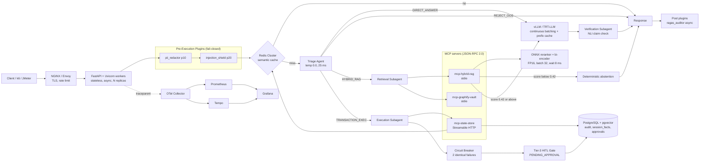
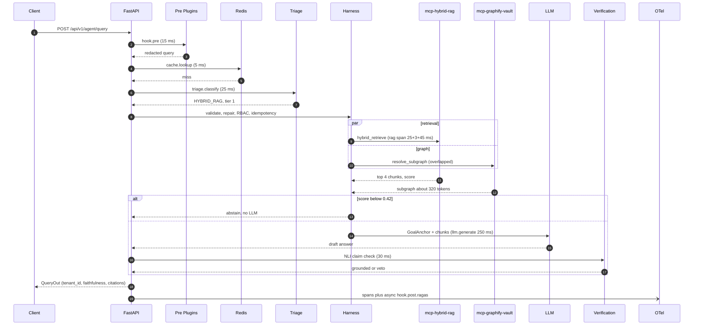
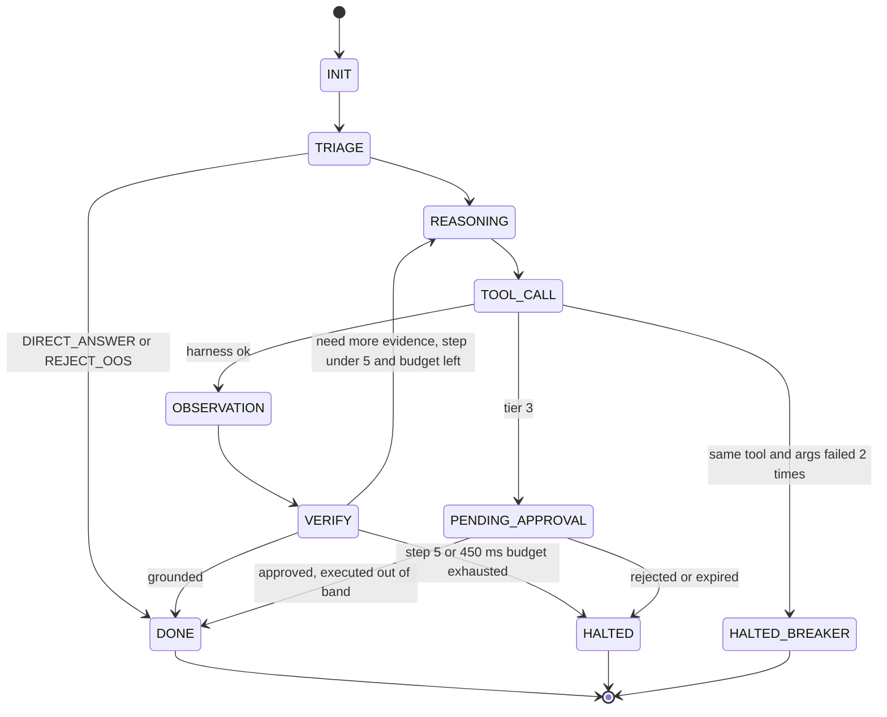
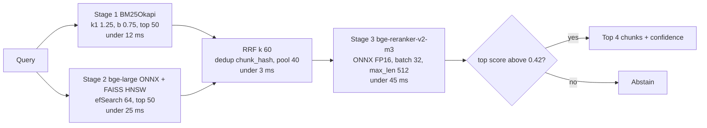
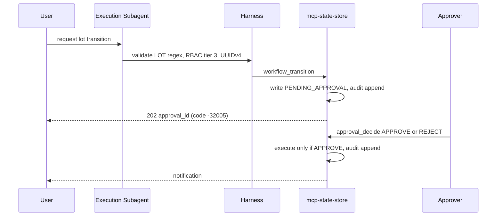
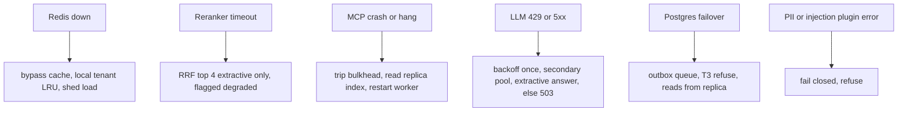

# finaldesign.md — Enterprise Agent Design ("The Unreliable Assistant" → Enterprise Grade)

| Field | Value |
|---|---|
| Status | **FINAL for lock review** (Gate 1). No application code until approved. |
| Source | `Unreliable_Assistant_MidCheck_Enterprise_Blueprint_v2.docx` (18 gates) |
| Supersedes | `design.md` (kept as audit trail) |
| Audience | Engineers / coding agents implementing the system |
| SLA | e2e p50 ≤ 240 ms · p95 ≤ 450 ms · p99 ≤ 590 ms at 50,000 concurrent VUs · 36 KPIs all pass |

**What this agent is:** a multi-tenant enterprise assistant that answers policy/SOP/catalog questions with cited, grounded answers (3-stage hybrid RAG) and handles gated transactions (human-in-the-loop for any mutation). Every tool is an MCP server; every cross-cutting rule is a hot-swappable plugin; the reasoning loop is bounded and deterministic.

**Prototype failures this design eliminates:** hallucinated facts · runaway tool loops · cross-user cache leaks · context drift · latency collapse under traffic (traceability in §16).

---

## 0. Reconciliation Decisions (the source docx contradicts itself; these are binding)

| # | Conflict in source | Decision |
|---|---|---|
| D1 | FAISS IVF-PQ (Gate 0) vs HNSW (Gate 3) | **HNSW**, efSearch=64. IVF-PQ only for corpora > ~50M vectors. |
| D2 | Reranker < 35 ms (Gate 0) vs < 45 ms (Gate 3 / KPI-09) | Budget **45 ms**; 35 ms stretch. |
| D3 | Triage < 30 ms (Gate 2) vs ≤ 25 ms (Gate 6 / KPI-05) | **25 ms**. |
| D4 | "Audit Subagent" (Gate 2) vs "Verification Subagent" (Gate 7) | **Verification Subagent**; "Audit" is an alias. |
| D5 | 5 steps × 120 ms = 600 ms > total loop budget 450 ms | **450 ms total is binding**; per-step timeout = min(120 ms, remaining budget). |
| D6 | Token reduction 55% / 45–65% / KPI-26 ≥ 45% | **Gate 45%, target 55%.** |
| D7 | 50K VUs with `sleep(1)` vs KPI-35 ≥ 8,500 RPS; k6 p50 < 250 vs KPI-31 ≤ 240 | KPI-35 is a floor; use varied queries + think time; tighten k6 thresholds to KPI values. |
| D8 | Span names differ between Gate 10 and KPI table | Use **Gate 10 names** (§10). |
| D9 | "End-to-end" undefined | e2e = request received → last byte of the non-streamed response. TTFT (KPI-25) applies only to the streaming endpoint. |
| D10 | k6 checks `tenant_id` in response | Response schema **must** echo `tenant_id` (and `faithfulness` for the JMeter JSONPath assertion). |
| D11 | Scorecard is "Tab 5" in Gate 12 text, "Tab 6" in Gate 18 | **Tab 6**. |
| D12 | Abstention "< 90 ms" cannot include triage + full rerank (127 ms) | Two abstention paths: **early-abstain < 90 ms** (weak/empty fused pool, no rerank) and **rerank-abstain ≤ 140 ms**; both skip the LLM and are reported separately from KPI-31..33 (§6). |
| D13 | LLM, hardware, domain unspecified | Defaults in §16.3 (swappable; budgets stay the same). |

---

## 1. System Charter & Hard Boundaries (Gate 1.1)

**Scope:** hybrid RAG over tenant knowledge vault; MCP-mediated tools; bounded ReAct reasoning; triage and subagent routing; HITL for mutations; observability, audit, KPI certification.

**Non-goals / hard boundaries**
1. **No autonomous clinical, financial or legal execution.** Any `risk_tier` ≥ 3 action requires human approval. No override flag exists.
2. No ungrounded answers: rerank top score < 0.42 ⇒ deterministic abstention, no LLM call.
3. No cross-tenant access: `tenant_id` in every Redis key and every SQL predicate.
4. No raw PII persisted (logs, cache, DB, traces).
5. Execution Subagent: no RAG, no web. Retrieval Subagent: no mutating tools.
6. No unbounded loops: `max_iterations=5`, `total_loop_budget=450 ms`.
7. No implementation code before this document is locked.

**Personas**
| Persona | Needs | Rights |
|---|---|---|
| End User | Fast, correct, cited answers; safe transaction requests | TIER_1, TIER_2; may *request* TIER_3 |
| Approver / Reviewer | Review and approve/reject `PENDING_APPROVAL` | Approve TIER_3 for own tenant only |
| Platform Engineer | Operate SLOs, runbooks, plugin toggles | Config only; no tenant content access |
| Red-Teamer / Auditor | Adversarial runs, audit-chain verification | Read audit log, run test harness |

**RBAC tiers:** `TIER_1_READ` (retrieval/lookup) · `TIER_2_COMPUTE` (validation/calculation/drafting, no side effects) · `TIER_3_MUTATE` (state change, HITL-gated).

---

## 2. Architecture (Gate 1.3)

### 2.A System topology



**Bulkheads (isolated pools):** `rag_pool=64`, `db_pool=128`, `llm_pool=256`; health checks and triage run on a reserved pool.
**Tenant boundary:** Redis key `t:{tenant_id}:{SHA256(tenant_id:user_id:norm_query)}`; SQL `WHERE tenant_id=$1` via a repository layer + Postgres RLS; vault queries scoped to tenant namespace.

### 2.B ASCII fallback

```
Client -> NGINX/Envoy -> FastAPI(N) -> [PII Redactor -> Injection Shield] -> Redis semantic cache
                                                                    | hit -> Response
                                                                    v miss
                                                         Triage (t=0, <=25ms)
        +---------------+---------------------+--------------------+
        |DIRECT_ANSWER  |HYBRID_RAG           |TRANSACTION_EXEC    |REJECT_OOS
        v               v                     v                    v
       LLM        Retrieval Subagent    Execution Subagent       Response
                   |        |                 |
        mcp-hybrid-rag  mcp-graphify-vault   Circuit Breaker -> Tier-3 HITL -> mcp-state-store -> Postgres
        BM25||Dense->RRF->Rerank(ONNX)
                   | score>=0.42 -> LLM -> Verification Subagent -> Response -> RAGAS(async)+OTel
                   | score <0.42 -> Deterministic abstention -> Response
```

### 2.C Request sequence (HYBRID_RAG, cache miss)



### 2.D Bounded ReAct state machine



### 2.E 3-stage RAG pipeline



### 2.F Tier-3 HITL / transaction flow



### 2.G Failure / fallback map



---

## 3. MCP Tool & Data Contracts (Gate 1.2)

Transport: JSON-RPC 2.0 over MCP; stdio for local workers (`hybrid-rag`, `graphify-vault`), Streamable HTTP/SSE for `state-store`. Server manifests are signed and verified at host start.

### 3.1 Shared types (Pydantic v2, strict, `extra="forbid"`)

```python
from pydantic import BaseModel, Field, ConfigDict
from typing import Annotated, Literal
from uuid import UUID

SKU      = Annotated[str, Field(pattern=r"^SKU-\d{3}$")]
LOT      = Annotated[str, Field(pattern=r"^LOT-\d{5}$")]
TenantId = Annotated[str, Field(pattern=r"^[a-z0-9_]{1,64}$")]
Tier     = Literal["TIER_1_READ", "TIER_2_COMPUTE", "TIER_3_MUTATE"]

class Base(BaseModel):
    model_config = ConfigDict(strict=True, extra="forbid")

class CallContext(Base):             # attached by the harness to EVERY tool call
    tenant_id: TenantId
    user_id: str = Field(max_length=64)
    session_id: UUID
    idempotency_key: UUID            # UUIDv4 enforced
    traceparent: str = Field(pattern=r"^00-[0-9a-f]{32}-[0-9a-f]{16}-0[01]$")
    tier: Tier
```

Auto-repair (deterministic, logged, never guesses): `SKU99`/`sku 99` → `SKU-099`; `lot 44`/`LOT44` → `LOT-00044`; trim/case-normalize. Ambiguous ⇒ `-32602`.

### 3.2 `mcp-hybrid-rag` (TIER_1_READ)

```python
class HybridRetrieveIn(Base):
    ctx: CallContext
    query: str = Field(min_length=1, max_length=2000)
    bm25_top_k: int = Field(50, ge=5, le=50)        # 25 in latency incident
    dense_top_k: int = Field(50, ge=5, le=50)
    rrf_k: int = Field(60, ge=1, le=200)
    fusion_pool: int = Field(40, ge=4, le=100)
    rerank_k: int = Field(4, ge=1, le=10)
    score_threshold: float = Field(0.42, ge=0.0, le=1.0)   # 0.55 in hallucination incident

class Chunk(Base):
    chunk_id: str; chunk_hash: str; text: str; source_uri: str
    bm25: float | None; cosine: float | None; rrf_rank: int | None; rerank: float | None

class HybridRetrieveOut(Base):
    chunks: list[Chunk]; top_score: float; abstain: bool; stage_ms: dict[str, float]
```
Resource: `rag://chunks/{chunk_id}` (tenant-scoped; cross-tenant id ⇒ `-32003`).

### 3.3 `mcp-graphify-vault` (TIER_1_READ)
`resolve_subgraph{ctx, query, anchor_hint?, depth 1..2 (default 2), max_tokens ≤ 400}` → `{anchor_id, nodes[{id, domain, risk_tier, version, text}], edges[[src,dst]], token_estimate}`.

### 3.4 `mcp-state-store`
| Tool | Tier | Input (besides `ctx`) | Output |
|---|---|---|---|
| `cache_get` | T1 | `key_hash` (64 hex) | `{hit, value?, cosine?}` |
| `cache_put` | T1 | `key_hash, value, ttl_s` (255..345) | `{ok}` |
| `session_facts_get` | T1 | `limit ≤ 50` | `{facts[{fact_id,text,verified_at}]}` |
| `session_facts_put` | T2 | `text ≤ 500, evidence_chunk_ids[]` | `{fact_id}` |
| `audit_append` | system | `event: AuditEvent` | `{seq, hash}` |
| `workflow_transition` | **T3** | `lot: LOT, from_state, to_state, reason` | `{status:"PENDING_APPROVAL", approval_id}` (never executes directly) |
| `approval_decide` | T3 (Approver) | `approval_id: UUID, decision, comment` | `{status}` |

Audit chain: `hash_n = SHA256(hash_{n-1} || canonical_json(event_n))`, per-tenant chains with fixed genesis.

### 3.5 Error codes
| Code | Name | Meaning / client behavior |
|---|---|---|
| -32700 | PARSE_ERROR | invalid JSON → fail |
| -32600 | INVALID_REQUEST | bad envelope → fail |
| -32601 | METHOD_NOT_FOUND | unknown tool → fail |
| -32602 | INVALID_PARAMS | validation failed after repair → feed back once to ReAct |
| -32603 | INTERNAL_ERROR | retry ≤ 1 if idempotent, then fallback |
| -32001 | TIMEOUT | per-call budget exceeded (RAG 150 ms) → FMEA fallback |
| -32002 | BREAKER_OPEN | `HALTED_BREAKER` |
| -32003 | RBAC_DENIED | tier/tenant violation → fail closed, audit |
| -32004 | PII_BLOCK | unredactable PII → fail closed |
| -32005 | PENDING_APPROVAL | HITL pending → 202 |
| -32006 | IDEMPOTENT_REPLAY | return original result |
| -32007 | INJECTION_BLOCKED | refuse |
| -32008 | ABSTAIN | below-threshold evidence → deterministic abstention |

### 3.6 Public API
`POST /api/v1/agent/query` (+ SSE `/api/v1/agent/query/stream` for KPI-25). Header `X-Tenant-ID` must equal body `tenant_id` (else 403).
```python
class QueryIn(Base):  tenant_id: TenantId; user_id: str; query: str = Field(max_length=4000); session_id: UUID | None = None
class QueryOut(Base):
    tenant_id: TenantId; session_id: UUID; trace_id: str
    status: Literal["ANSWERED","ABSTAINED","REFUSED","PENDING_APPROVAL","HALTED_BREAKER"]
    answer: str | None; citations: list[str]; faithfulness: float | None
    approval_id: UUID | None; remediation: str | None
```

### 3.7 Stack and `mcp_config.json`
| Layer | Tool | Binding |
|---|---|---|
| Runtime/API | Python 3.11 + FastAPI + Uvicorn | MCP host client (`mcp.ClientSession`) |
| Retrieval | Rank-BM25 + FAISS HNSW + BGE-Large | `mcp-hybrid-rag` |
| Reranker | ONNX Runtime `bge-reranker-v2-m3` FP16 | in-process / Triton microservice |
| State | PostgreSQL (pgvector) + Redis Cluster | `mcp-state-store` |
| Token compression | Obsidian Vault + Graphify | `mcp-graphify-vault` |
| Plugins | Pluggy / entry-point registry | Pre, Post, PII, OTel, HITL |

```json
{
  "mcpServers": {
    "hybrid-rag": {"command": "uv", "args": ["run", "mcp_servers/rag_server.py"], "transport": "stdio", "timeout_ms": 150},
    "state-store": {"url": "http://localhost:8081/mcp", "transport": "streamable-http", "pool_size": 200},
    "graphify-vault": {"command": "uv", "args": ["run", "mcp_servers/graphify_server.py"], "transport": "stdio"}
  },
  "plugins": [
    {"name": "pii_redactor", "stage": "PRE_EXECUTION", "priority": 10, "fail_closed": true},
    {"name": "injection_shield", "stage": "PRE_EXECUTION", "priority": 20, "fail_closed": true},
    {"name": "circuit_breaker", "stage": "TOOL_DISPATCH", "priority": 10, "max_identical_calls": 2},
    {"name": "ragas_auditor", "stage": "POST_EXECUTION", "priority": 10, "min_faithfulness": 0.92},
    {"name": "otel_exporter", "stage": "ALL_SPANS", "endpoint": "http://localhost:4317"}
  ]
}
```
Plugin interface (Pluggy):
```python
class Plugin(Protocol):
    name: str; stage: Literal["PRE_EXECUTION","TOOL_DISPATCH","POST_EXECUTION","ALL_SPANS"]
    priority: int; fail_closed: bool
    async def run(self, state: "AgentState") -> "HookResult": ...   # ALLOW | MODIFY | BLOCK
```
Lower priority number runs first. `fail_closed` + plugin error/timeout ⇒ request refused. `pii_redactor` and `injection_shield` cannot be hot-disabled.

---

## 4. Core Components

### 4.1 ToolExecutionHarness (Gate 4)
Every MCP call, in order: (1) Pydantic v2 strict validation → (2) deterministic regex auto-repair → (3) RBAC tier check → (4) UUIDv4 idempotency → circuit breaker → dispatch.

### 4.2 Bounded loop
States: `INIT → TRIAGE → REASONING → TOOL_CALL → OBSERVATION → VERIFY → DONE/HALTED`. Hard limits: `max_iterations=5`, `per_step_timeout=min(120 ms, remaining)`, `total_loop_budget=450 ms`, zero recursive self-calls without state mutation. Target mean ≤ 2.2 steps (KPI-17).

### 4.3 Context retention (Gate 5)
1. **Immutable `GoalAnchorBlock`** (original intent, normalized entity IDs, active policy constraints) at index 0 of every prompt.
2. **Observation compression:** extractive; strip boilerplate JSON keys; ≤ 180 tokens.
3. **Sliding window + dual memory:** last 3 turns hot (Redis/RAM); verified facts in Postgres `session_facts` keyed by `session_id` (+ `tenant_id`).

### 4.4 Triage (Gates 6–7)
Distilled classifier, temperature 0.0, ≤ 25 ms; outputs `(intent, domain, risk_tier, complexity)`; routes to `DIRECT_ANSWER | HYBRID_RAG | TRANSACTION_EXEC | REJECT_OOS`. `risk_tier=3` always forces HITL regardless of route.

| Subagent | Responsibility | Bound MCP | Isolation |
|---|---|---|---|
| Retrieval | Query rewrite, 3-stage RAG, citation grounding | hybrid-rag, graphify-vault | Read-only; no mutating tools |
| Execution | Schema validation, submissions, workflow transitions | state-store | No RAG/web; T3 ⇒ HITL freeze |
| Verification | Claim→chunk NLI, RAGAS triad, OTel logging | state-store (audit only) | Independent context; vetoes ungrounded drafts |

### 4.5 Reliability patterns (Gate 9)
1. **Idempotent circuit breaker:** `(tool_name, canonical_args_hash)` fails ≥ 2 ⇒ `HALTED_BREAKER` + structured remediation prompt.
2. **Bulkheads:** `rag_pool=64`, `db_pool=128`, `llm_pool=256`.
3. **Deterministic abstention:** score < 0.42 ⇒ skip LLM, fixed template (zero hallucination, ~80% token savings). Two paths per D12.
4. **Async HITL gate:** T3 writes `PENDING_APPROVAL` to Postgres, pauses until an authorized reviewer approves via UI/API; never auto-approves; expires to `REJECTED`.

### 4.6 3-Stage RAG (Gates 3 & 8) — in `mcp_servers/rag_server.py`
| Stage | Engine | Hyperparameters | Budget | Output |
|---|---|---|---|---|
| 1 Sparse | BM25Okapi + PorterStemmer + inverted index | k1=1.25, b=0.75, top_k=50, pre-tokenized | < 12 ms | 50 candidates + raw scores |
| 2 Dense | `bge-large-en-v1.5` ONNX + FAISS HNSW | chunk 512 tok, overlap 64, efSearch 64, top_k 50 | < 25 ms | 50 candidates + cosine |
| Fusion | RRF | k=60, dedup `chunk_hash`, pool 40 | < 3 ms | 40 fused |
| 3 Cross-encoder | `bge-reranker-v2-m3` ONNX FP16 | batch 32, rerank_k 4, sigmoid > 0.42, max_len 512 | < 45 ms | 4 chunks + confidence |

---

## 5. Token Optimization (Gate 17) — gate ≥ 45%, target 55%
1. **Atomic Obsidian vault** `knowledge_vault/`: every policy/SOP/catalog item an atomic note; YAML frontmatter `id`, `domain`, `risk_tier`, `version`; explicit `[[wikilinks]]`.
2. **Graphify subgraph pruning:** `graphify build ./src ./knowledge_vault --output graph.json` (Python modules, Pydantic schemas, policy nodes). At runtime `mcp-graphify-vault` resolves the anchor node and traverses ≤ `depth=2`, injecting only the connected subgraph (~320 tokens vs ~1,400).

---

## 6. Latency Budget (Gate 1.4)

e2e = request received → last byte of response (D9). Post-hook RAGAS runs async, off the critical path.

### Path A — HYBRID_RAG, cache miss (p95)
| # | Hop (span) | ms |
|---|---|---|
| 1 | Gateway + API accept | 5 |
| 2 | `hook.pre` (PII → injection) | 15 |
| 3 | `cache.lookup` | 5 |
| 4 | `triage.classify` | 25 |
| 5 | MCP JSON-RPC overhead | 4 |
| 6 | BM25 ∥ dense (parallel, max) | 25 |
| 7 | RRF | 3 |
| 8 | Rerank | 45 |
| 9 | Graphify (overlapped with 6–8) | 0 |
| 10 | Prompt assembly + compression | 5 |
| 11 | `llm.generate` | 250 |
| 12 | Verification (NLI) | 30 |
| 13 | Serialize + egress | 10 |
| | **Sum** | **422** |
| | Headroom (queueing, GC, batch wait 8 ms) | 28 |
| | **Total p95** | **450** ✔ KPI-32 |

p99 ≤ 590 ms (KPI-33): tail allowance is queueing and batch wait only; **no retry** on this path.

### Other paths
| Path | p95 target | Notes |
|---|---|---|
| Cache hit | ≤ 60 ms | 5+15+5 + egress |
| **Early-abstain** | **< 90 ms** | 5+15+5+25+4+25+3 = 82 ms; no rerank, no LLM (empty/weak fused pool) |
| **Rerank-abstain** | ≤ 140 ms | 127 ms + egress; no LLM |
| DIRECT_ANSWER | ≤ 300 ms | no retrieval |
| TRANSACTION_EXEC | ≤ 200 ms to `PENDING_APPROVAL` | approval wait out-of-band, excluded from SLA |
| REJECT_OOS | ≤ 60 ms | no LLM |

Early-abstain condition: fused pool empty, or max cosine < 0.30 **and** max BM25 normalized < 0.10 (calibrate on the negative set; recorded in ADR-6).

### Capacity model (50K VUs; validate in load test)
- Offered ≈ 50,000 / (≈3 s think + 0.3 s) ≈ 15K RPS peak; KPI-35 floor 8,500 RPS sustained.
- FastAPI ≥ 40 workers (HPA, 2× headroom → 80), ~400–600 RPS/worker on cache-miss path.
- Redis Cluster ≥ 6 nodes (3 primary + 3 replica); ≥ 35% hit ratio removes ≥ 5K RPS from RAG.
- Reranker ≥ 6 replicas (batch 32, wait 8 ms).
- vLLM/TRT-LLM continuous batching + prefix caching; abstentions and cache hits bypass LLM.
- Load: k6 ≥ 10 injectors; JMeter 1 controller + 10 workers × 5,000 threads.
- Deployment: stateless FastAPI behind NGINX/Envoy.

---

## 7. KPI & SLA Gate Matrix (36 KPIs — all hard CI/CD gates, shown in Streamlit Tab 6)

| ID | Stage | Metric | Threshold | Tool / span |
|---|---|---|---|---|
| KPI-01 | 1 Ingress & Triage | Pre-hook guardrail latency p95 | ≤ 15 ms | `hook.pre` |
| KPI-02 | 1 Ingress & Triage | PII redaction recall (email/phone/SSN/obfuscated) | ≥ 99.8% | Presidio / regex audit |
| KPI-03 | 1 Ingress & Triage | Prompt-injection block rate (direct+indirect) | ≥ 99.5% | Red-team benchmark |
| KPI-04 | 1 Ingress & Triage | Triage routing accuracy | ≥ 97.0% | Labeled intent set |
| KPI-05 | 1 Ingress & Triage | Triage latency p95 | ≤ 25 ms | `triage.classify` |
| KPI-06 | 1 Ingress & Triage | False-positive refusal on benign | ≤ 1.0% | Benign control set |
| KPI-07 | 2 Hybrid Retrieval | BM25 latency p95 | ≤ 12 ms | `mcp.rag.bm25` |
| KPI-08 | 2 Hybrid Retrieval | Bi-encoder + FAISS latency p95 | ≤ 25 ms | `mcp.rag.biencoder` |
| KPI-09 | 2 Hybrid Retrieval | Cross-encoder latency p95 | ≤ 45 ms | `mcp.rag.rerank` |
| KPI-10 | 2 Hybrid Retrieval | Hybrid Context Recall@50 | ≥ 0.92 | RAGAS / IR eval |
| KPI-11 | 2 Hybrid Retrieval | Post-rerank Context Precision@4 | ≥ 0.88 | RAGAS |
| KPI-12 | 2 Hybrid Retrieval | MRR@4 | ≥ 0.85 | IR script |
| KPI-13 | 2 Hybrid Retrieval | nDCG@4 | ≥ 0.86 | IR script |
| KPI-14 | 3 Agent & Loop | Tool schema first-pass validation rate | ≥ 96.0% | Pydantic telemetry |
| KPI-15 | 3 Agent & Loop | Auto-repair success on malformed args | ≥ 90.0% | Harness metrics |
| KPI-16 | 3 Agent & Loop | Infinite-loop escape rate (breaker) | 100.0% | Chaos loop suite |
| KPI-17 | 3 Agent & Loop | Mean ReAct steps per completed task | ≤ 2.2 | `agent.react.step` count |
| KPI-18 | 3 Agent & Loop | Context drift (goal cosine alignment) | ≥ 0.85 | Embedding drift audit |
| KPI-19 | 3 Agent & Loop | Tier-3 HITL gate enforcement | 100.0% | Audit-log integrity |
| KPI-20 | 4 Generation & RAGAS | Faithfulness | ≥ 0.92 | `hook.post.ragas` |
| KPI-21 | 4 Generation & RAGAS | Answer relevancy | ≥ 0.90 | `hook.post.ragas` |
| KPI-22 | 4 Generation & RAGAS | Context entity recall | ≥ 0.85 | `hook.post.ragas` |
| KPI-23 | 4 Generation & RAGAS | Unanswerable abstention accuracy | ≥ 98.0% | Negative test set |
| KPI-24 | 4 Generation & RAGAS | Unsupported-claim / hallucination rate | ≤ 0.5% | NLI verifier |
| KPI-25 | 4 Generation & RAGAS | TTFT p95 (streaming) | ≤ 180 ms | FastAPI stream metric |
| KPI-26 | 5 Token & Graphify | Prompt-token reduction | ≥ 45.0% (target 55%) | Token counter hook |
| KPI-27 | 5 Token & Graphify | Semantic cache hit ratio (steady state) | ≥ 35.0% | Redis hit/miss |
| KPI-28 | 5 Token & Graphify | Cross-tenant cache isolation | 100% (0 leaks) | Concurrency probe |
| KPI-29 | 5 Token & Graphify | Cost per 1,000 queries | ≤ $0.45 | OTel token-cost calc |
| KPI-30 | 5 Token & Graphify | MCP JSON-RPC serialization overhead p95 | ≤ 4 ms | MCP client timer |
| KPI-31 | 6 Scale & Load | e2e p50 @ 50K VUs | ≤ 240 ms | k6 + JMeter |
| KPI-32 | 6 Scale & Load | e2e p95 @ 50K VUs | ≤ 450 ms | k6 + JMeter |
| KPI-33 | 6 Scale & Load | e2e p99 @ 50K VUs | ≤ 590 ms | k6 + JMeter |
| KPI-34 | 6 Scale & Load | HTTP 5xx rate @ 50K VUs | ≤ 0.05% | k6 / JMeter |
| KPI-35 | 6 Scale & Load | Sustained throughput | ≥ 8,500 RPS | k6 / JMeter |
| KPI-36 | 6 Scale & Load | RSS growth over 1-h soak | ≤ 3.0% | Prometheus node exporter |

**RAGAS release gates** (250-question golden set: Factoid 25%, Complex Reasoning 25%, Multi-Hop 20%, Summary 15%, Negative/Unanswerable 15%): Faithfulness ≥ 0.92 · Answer Relevancy ≥ 0.90 · Context Precision ≥ 0.88 · Context Recall ≥ 0.85 · Context Entity Recall ≥ 0.85. Runs in CI on every change to retrieval, prompts, models or index (Step 8: continuous evaluation) and sampled in production via `ragas_auditor`. KPIs 1–30 run per PR; KPIs 31–36 on full 50K runs.

---

## 8. FMEA (Gate 1.6 — 12 rows)

| # | Failure | Sev | Detection | Deterministic fallback | Runbook |
|---|---|---|---|---|---|
| 1 | Redis down/slow | High | cache span errors, Redis CPU | Bypass cache (read cache only); tenant-keyed local LRU 60 s; token-bucket load shed; never unscoped keys | R-CACHE |
| 2 | Reranker timeout (> 45 ms) | High | `mcp.rag.rerank` timeout | RRF top-4, extractive-quote-only answer flagged `degraded`; abstain below calibrated RRF floor | R-RERANK |
| 3 | `mcp-hybrid-rag` crash/hang (> 150 ms, > 1%) | High | JSON-RPC timeout rate | Trip bulkhead breaker; failover to cached read-replica index; restart worker; else `HALTED_BREAKER` | R-MCP |
| 4 | Low/empty evidence | Med | score < 0.42 or empty pool | Deterministic abstention, no LLM | R-ABSTAIN |
| 5 | LLM 429/5xx | High | `llm.generate` status | One jittered retry inside budget → secondary pool → extractive answer → `503` + `Retry-After` | R-LLM |
| 6 | Postgres primary failover | High | `db_pool` errors | Writes to durable outbox; **T3 refuses (fail closed)**; reads from replica; audit append retried, never dropped | R-PG |
| 7 | PII redactor error/timeout | Crit | plugin exception | Fail closed: refuse (`-32004`) | R-PII |
| 8 | Injection shield error/timeout | Crit | plugin exception | Fail closed: refuse (`-32007`) | R-INJ |
| 9 | Infinite tool loop | Med | breaker (2 identical failures) | `HALTED_BREAKER` + remediation prompt | R-LOOP |
| 10 | HITL reviewer unavailable / stale | Med | pending age > SLA | Stay `PENDING_APPROVAL`; escalate; expire to `REJECTED`; never auto-approve | R-HITL |
| 11 | Cache stampede / tenant key collision | High | Redis CPU > 85%, collision probe | Enforce `SHA256(tenant:user:norm_query)` prefix, jittered TTL 300 ± 45 s, single-flight lock, purge namespace | R-STAMPEDE |
| 12 | OTel collector down / stale FAISS index | Med | exporter errors / index version mismatch | Bounded ring buffer (drop-oldest, count drops), serving unaffected; stale index served with `index_version` flag + alert | R-OBS |

---

## 9. Architecture Decision Records (Gate 1.7)

**ADR-1 Hybrid retrieval via RRF k=60, not weighted sum.** BM25 and cosine scales are incomparable; RRF is scale-free, needs no per-corpus tuning, tolerates one retriever failing. Dedup by `chunk_hash`, pool 40 → rerank → top 4. Revisit if KPI-10 < 0.92.

**ADR-2 ONNX FP16 (INT8 CPU fallback) + dynamic micro-batching.** `bge-reranker-v2-m3` and `bge-large-en-v1.5` exported to ONNX; batch 32, max wait 8 ms. Guardrail: ≤ 1% absolute drop in nDCG@4/MRR@4 versus FP32 or quantization is rejected.

**ADR-3 Redis tenant-scoped hashed keys.** `t:{tenant_id}:{SHA256(tenant_id:user_id:norm_query)}`, jittered TTL 300 ± 45 s, single-flight; semantic matches only inside the tenant namespace (cosine ≥ 0.92 in latency incident). Prevents leaks (KPI-28) and stampedes; cost is lower cross-user hit rate, offset by allow-listed tenant-level shared policy queries.

**ADR-4 Bounded ReAct.** Max 5 steps, 450 ms budget, no recursive self-calls; budgets enforced by the harness, not the LLM; breaker on `(tool, args_hash)`. Removes runaway loops; makes latency provable (D5).

**ADR-5 FAISS HNSW over IVF-PQ.** efSearch 64, top_k 50: better recall at low latency for small/medium corpora; costs more memory. IVF-PQ reserved for very large corpora.

**ADR-6 Abstention at rerank score < 0.42 (and early-abstain).** No LLM below threshold; fixed template; threshold 0.55 + strict extractive mode in hallucination incident. Thresholds calibrated on the negative set (15% of golden set); recalibrate after any model/index change.

---

## 10. Observability & Incident Response (Gates 10–11)

W3C `traceparent` on every hop including MCP calls → OTel Collector → Prometheus + Tempo + Grafana. Spans: `hook.pre`, `cache.lookup`, `triage.classify`, `mcp.rag.bm25`, `mcp.rag.biencoder`, `mcp.rag.rrf`, `mcp.rag.rerank`, `agent.react.step`, `llm.generate`, `hook.post.ragas`.

| Scenario | Alert trigger | Mitigation / runbook |
|---|---|---|
| Latency breach (> 600 ms) | p95 e2e > 550 ms for 30 s | Aggressive semantic cache (cosine ≥ 0.92); BM25/dense `top_k` 50 → 25 |
| Hallucination surge | RAGAS faithfulness < 0.90 (5 min window) | Cross-encoder cutoff 0.42 → 0.55; strict extractive quote mode |
| MCP server hang | JSON-RPC timeout > 150 ms (> 1% rate) | Trip MCP bulkhead circuit; failover to cached read-replica index; restart worker |
| Cache stampede / leak | Tenant key collision or Redis CPU > 85% | Enforce `SHA256(tenant_id:user_id:norm_query)` prefix + jittered TTL 300 ± 45 s |

---

## 11. Governance, Security & Red Teaming (Gates 13–14)

- SHA-256 hash-chained immutable audit logs (`prev_hash + event_payload`); nightly chain verification (KPI-19 evidence).
- Strict tenant isolation: `tenant_id` in every SQLite/Postgres query and Redis key; Postgres RLS.
- Zero raw PII persisted: redact before cache, logs, traces, DB.
- Signed MCP server manifests verified at startup; unsigned/changed manifests refuse to load.
- Secrets from secret manager only; least-privilege DB roles.

**Red-team suite (100 automated prompts; split 25/25/20/15/15):** (1) direct jailbreaks and system-prompt extraction; (2) indirect prompt injection hidden in retrieved Obsidian/PDF chunks; (3) multi-turn crescendo social engineering; (4) Unicode homoglyph and `name[at]domain` PII smuggling; (5) tool-argument overflow / SQLi fuzzing. Feeds KPI-02, 03, 06.

---

## 12. Testing & Load (Gates 8, 14–16)

| Suite | Scope | Gates |
|---|---|---|
| Golden set | 250 questions, stratified | KPI-10, 11, 20–23 + RAGAS release gates |
| Red team | 100 prompts | KPI-02, 03, 06 |
| Chaos | Infinite SKU retry loop; fault injection per FMEA row | KPI-16, FMEA |
| Isolation probe | Concurrent multi-tenant identical queries | KPI-28 |
| k6 | `load_tests/k6_50k_load.js` | KPI-31–35 |
| JMeter | `load_tests/jmeter_50k_plan.jmx` | KPI-31–35 |
| Soak | 1 h steady load | KPI-36 |

**k6 (source script; tighten thresholds to p50<240 and p99<590 per D7, and vary queries so cache-hit ratio is realistic):**
```javascript
import http from 'k6/http';
import { check, sleep } from 'k6';
export const options = {
  stages: [
    { duration: '2m', target: 10000 },
    { duration: '3m', target: 50000 },
    { duration: '5m', target: 50000 },
    { duration: '2m', target: 0 },
  ],
  thresholds: {
    'http_req_duration': ['p(50)<250', 'p(95)<450', 'p(99)<600'],
    'http_req_failed': ['rate<0.0005'],
    'checks': ['rate>0.999'],
  },
};
export default function () {
  const vuId = __VU;
  const payload = JSON.stringify({
    tenant_id: `tenant_${vuId % 50}`,
    user_id: `user_${vuId}`,
    query: 'Verify batch LOT-88392 safety protocol and return triage status'
  });
  const params = { headers: { 'Content-Type': 'application/json', 'X-Tenant-ID': `tenant_${vuId % 50}` } };
  const res = http.post('http://localhost:8000/api/v1/agent/query', payload, params);
  check(res, {
    'status is 200': (r) => r.status === 200,
    'latency within 200-600ms SLA': (r) => r.timings.duration <= 600,
    'no cross-tenant leak': (r) => r.json('tenant_id') === `tenant_${vuId % 50}`,
  });
  sleep(1);
}
```

**JMeter:** 1 controller + 10 distributed workers (5,000 threads each = 50,000 VUs), ramp-up 180 s, infinite loop over 600 s, non-GUI:
`jmeter -n -t jmeter_50k_plan.jmx -R worker1..worker10 -l results_50k.jtl -e -o dashboard_50k/`
Assertions/listeners: Duration Assertion (600 ms), JSONPath Assertion (`$.faithfulness >= 0.92`), Constant Throughput Timer, Backend Listener (InfluxDB/Prometheus), validating JDBC/SQLite persistence and HTTP endpoints together.

---

## 13. Streamlit Developer Workbench — `app.py` (Gate 18)

| Tab | Controls and inspectors |
|---|---|
| 1 Architecture & Workflow | `design.md` contract checklist; `docs/workflow_orchestration.png`; live Triage routing console; ReAct step-by-step trace accordion; Tier-3 HITL Approve/Reject queue |
| 2 3-Stage Hybrid RAG Lab | Side-by-side BM25 scores, bi-encoder cosine, RRF fused ranks, cross-encoder scores; sliders `k1`, `b`, `RRF k`, `threshold` |
| 3 MCP & Plugin Inspector | Live status of `hybrid-rag`, `state-store`, `graphify-vault`; JSON-RPC payload inspector; hot-toggles for Pre/Post plugins (security plugins locked) |
| 4 Memory & Graphify Tokens | Graphify subgraph visualizer; Obsidian note viewer; live SQLite/Redis session-state browser; token-savings and cost-reduction gauge |
| 5 Red Team & Circuit Breaker | One-click runner: direct/indirect injections, obfuscated PII, infinite SKU retry loop, cross-tenant cache probe; breaker trip/reset |
| 6 36-KPI Scorecard & 50K Load | Live OTel span waterfall; RAGAS triad gauges; k6/JMeter latency histogram (p50/p95/p99 vs 200–600 ms SLA); automated 36-KPI pass/fail scorecard |

**Gate 2 diagram** `docs/workflow_orchestration.png`: Graphviz (`diagrams`/`graphviz`), **300 DPI**, generated *before* application logic and rendered in Tab 1. Must show: Ingress → Pre plugins (PII Redactor → Injection Classifier) → Redis semantic cache check; Triage (temp 0.0, ≤ 25 ms) → Direct / Retrieval / Execution / Verification (Audit); MCP JSON-RPC calls to `mcp-hybrid-rag` (BM25 + bi-encoder → RRF → cross-encoder), `mcp-graphify-vault`, `mcp-state-store`; Bounded ReAct (`max_steps=5`) → Circuit Breaker → Tier-3 HITL → Post RAGAS + OTel export. Sections 2.A–2.G are the source for it.

---

## 14. Agent Build Blueprint

### 14.1 Repository layout
```
H1/
├─ finaldesign.md  design.md
├─ mcp_config.json
├─ app.py                      # Streamlit workbench (Gate 18)
├─ agent/
│  ├─ api.py                   # FastAPI app, /query, /query/stream
│  ├─ loop.py                  # bounded ReAct state machine
│  ├─ harness.py               # ToolExecutionHarness
│  ├─ triage.py                # classifier + router
│  ├─ memory.py                # GoalAnchorBlock, compressor, window, session_facts
│  ├─ subagents/{retrieval,execution,verification}.py
│  ├─ models.py                # Pydantic v2 contracts (§3)
│  └─ errors.py                # error-code table
├─ plugins/                    # pii_redactor, injection_shield, circuit_breaker, ragas_auditor, otel_exporter
├─ mcp_servers/{rag_server,graphify_server,state_server}.py
├─ knowledge_vault/            # atomic Obsidian notes
├─ evals/{golden_250.jsonl,redteam_100.jsonl,run_ragas.py,ir_bench.py}
├─ load_tests/{k6_50k_load.js,jmeter_50k_plan.jmx}
├─ docs/workflow_orchestration.png
└─ tests/
```

### 14.2 Module → gate map
`harness.py`, `loop.py` → G4 · `memory.py` → G5 · `triage.py`, `subagents/*` → G6–7 · `plugins/circuit_breaker`, bulkheads, abstention, HITL → G9 · `rag_server.py` → G3, G8 · `plugins/otel_exporter` → G10–11 · `state_server.py` audit chain → G13 · `evals/redteam` → G14 · `load_tests/*` → G15–16 · `graphify_server.py`, `knowledge_vault/` → G17 · `app.py` → G18.

### 14.3 Agent prompt skeletons (all at temperature 0.0 unless noted)
- **Triage:** "Classify the user query into `{intent, domain, risk_tier 1-3, complexity}` and a route in `{DIRECT_ANSWER, HYBRID_RAG, TRANSACTION_EXEC, REJECT_OOS}`. Output JSON only. Any state-changing request is risk_tier 3. Out-of-scope or policy-violating requests are REJECT_OOS."
- **Reasoning (ReAct), index 0 = GoalAnchorBlock (immutable):** "Goal: {original_intent}. Entities: {normalized_ids}. Constraints: {policy}. Use only the allowed tools for your subagent. Answer only from provided chunks and cite chunk ids. If evidence is insufficient, say so. Never repeat a failed call."
- **Verification (independent context):** "Given draft and chunks, split into atomic claims; for each, return ENTAILED / NOT_ENTAILED with the supporting chunk id. If any claim is NOT_ENTAILED, veto."
- **Abstention template (deterministic, no LLM):** "I don't have sufficient verified information to answer that. Try rephrasing, or contact the policy owner. (ref: {trace_id})"

### 14.4 Build order with exit criteria
| Step | Deliverable | Exit criterion |
|---|---|---|
| 1 | Gate 2 diagram PNG (300 DPI) | PNG present, shows all four layers |
| 2 | `models.py`, `errors.py`, harness, loop, breaker | unit tests: repair rules, RBAC, idempotency, loop limits; KPI-14/15/16 chaos suite pass |
| 3 | `state_server` + audit hash chain | chain verifies; RLS tests; KPI-19, KPI-28 probe |
| 4 | `rag_server` stage by stage | per-stage latency KPI-07/08/09; KPI-10–13 on IR set |
| 5 | Triage + subagents + HITL | KPI-04/05; T3 can never execute without approval |
| 6 | Plugins (PII, injection, RAGAS, OTel) | KPI-01/02/03/06 |
| 7 | Vault + Graphify | KPI-26 ≥ 45% |
| 8 | Golden set + red team in CI | RAGAS gates, KPI-20–24 |
| 9 | k6 + JMeter at 50K | KPI-30–36 |
| 10 | Streamlit workbench | 6 tabs live; scorecard reads real metrics |
| 11 | Full 36-KPI certification | all pass |

---

## 15. Source Gate → Section Coverage

| Gate | Section(s) | Gate | Section(s) |
|---|---|---|---|
| 0 | §3.7, §2.A | 10–11 | §10 |
| 1 | §1–§9 | 12 | §7 |
| 2 | §13, §2 | 13–14 | §11 |
| 3 & 8 | §4.6, §3.2, §7 | 15–16 | §6, §12 |
| 4 | §4.1–4.2 | 17 | §5 |
| 5 | §4.3 | 18 | §13 |
| 6–7 | §4.4 | 9 | §4.5, §8 |

## 16. Traceability and Defaults

### 16.1 Prototype failure → control → KPI
| Failure | Controls | KPIs |
|---|---|---|
| Hallucinated facts | 3-stage RAG, 0.42 abstention, Verification NLI veto, RAGAS gate | 20, 23, 24 |
| Runaway tool loops | Bounded ReAct, circuit breaker, idempotency | 16, 17 |
| Cross-user cache leaks | Tenant-scoped hashed keys, RLS, isolation probe | 28 |
| Context drift | Goal anchor, observation compression, window + `session_facts` | 18 |
| Latency collapse | Budgets, bulkheads, batching, cache, horizontal scale | 31–36 |

### 16.2 Locking checklist
All 13 reconciliation decisions accepted · 36 KPIs reviewed · 12 FMEA rows reviewed · 6 ADRs accepted · defaults in §16.3 accepted.

### 16.3 Defaults for items the source leaves open (swappable without changing budgets)
- **LLM:** a vLLM-served open-weights instruct model for generation; a small distilled encoder classifier for triage. Must hit 250 ms generation budget and KPI-29 ≤ $0.45 / 1K queries; if not, switch model, not budget.
- **Hardware:** GPU FP16 for reranker/bi-encoder (INT8 CPU as fallback); sizing per §6 capacity model.
- **Domain:** domain-neutral; SKU/LOT examples from the source are used as the transaction domain; replace regexes in §3.1 for another domain.
